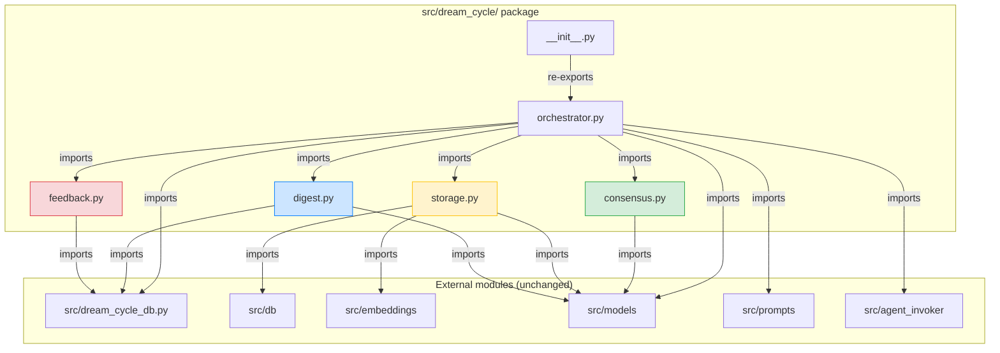

# Design Document: Dream Cycle Decomposition

## Overview

This design describes the structural decomposition of the monolithic `src/dream_cycle.py` (43KB, 13 methods in `DreamCycleOrchestrator`) into a `src/dream_cycle/` Python package with focused, single-responsibility modules. The refactor is purely structural — no behavioral changes. The existing `src/dream_cycle_db.py` stays as-is but receives 3 new query functions extracted from the orchestrator.

The decomposition follows a strict incremental sequence where each step is independently verifiable: all 124 existing tests must pass after every extraction. The primary risk is the 80 `patch("src.dream_cycle.X")` targets in test files that must be updated when symbols move to submodules.

## Architecture

### Target Package Structure

```
src/dream_cycle/
├── __init__.py          # Re-exports DreamCycleOrchestrator
├── orchestrator.py      # Pipeline coordination: run(), _run_pipeline(), invoke_*, _invoke_evaluator_safe, _is_second_deferral
├── consensus.py         # Pure function: tally_consensus()
├── storage.py           # Memory persistence: store_accepted(), check_duplicate()
├── digest.py            # Markdown rendering: generate_digest()
└── feedback.py          # Rejection formatting: build_feedback_injection()
```

### Module Dependency Diagram



### Extraction Sequence

Each step is an atomic commit. The sequence is ordered by risk (highest first) and dependency:

| Step | Module | Risk | Patch Changes | Rationale |
|------|--------|------|---------------|-----------|
| 1 | Package skeleton | Highest | 80 patches change `src.dream_cycle.X` → `src.dream_cycle.orchestrator.X` | Delete `src/dream_cycle.py`, create package; all tests break if wrong; must be done first |
| 2 | consensus.py | Lowest | 0 | Pure function, no patch targets move |
| 3 | storage.py | High | 47 patches move to `src.dream_cycle.storage` | Biggest batch of patch migrations |
| 4 | Digest DB queries | Low | 0 | Adds functions to dream_cycle_db.py, no moves |
| 5 | digest.py | Medium | 4 `src.db.get_connection` patches replaced with `dream_cycle_db` mocking | Depends on step 4 |
| 6 | feedback.py | Medium | `dream_cycle_db` patches in feedback tests move | Independent of digest |
| 7 | Orchestrator cleanup | Low | 14 `patch.object` targets replaced with `mock_db.get_previous_run_id` | DRY evaluator loop, remove dead code |


## Components and Interfaces

### 1. `src/dream_cycle/__init__.py`

```python
"""Dream Cycle package — re-exports the orchestrator."""
from src.dream_cycle.orchestrator import DreamCycleOrchestrator

__all__ = ["DreamCycleOrchestrator"]
```

This ensures `from src.dream_cycle import DreamCycleOrchestrator` continues to work in `scripts/dream_cycle_run.py` without modification.

### 2. `src/dream_cycle/orchestrator.py`

After all extractions, the orchestrator retains only pipeline coordination methods:

```python
"""Dream Cycle Orchestrator — four-agent pipeline coordination."""
from __future__ import annotations

import json
import logging
import os
from dataclasses import asdict
from datetime import datetime, timezone

import psycopg2

from src.agent_invoker import AgentInvoker
from src.models import CandidateInsight, DreamCycleResult, EvaluatorVerdict, MemorySlice
from src.prompts import get_evaluator_prompt, get_explorer_prompt, get_thinker_prompt
import src.dream_cycle_db as dream_cycle_db

from src.dream_cycle.consensus import tally_consensus
from src.dream_cycle.storage import store_accepted, check_duplicate
from src.dream_cycle.digest import generate_digest
from src.dream_cycle.feedback import build_feedback_injection

logger = logging.getLogger(__name__)
DEFAULT_MCP_CONFIG = os.path.expanduser("~/.kiro/settings/mcp.json")


class DreamCycleOrchestrator:
    def __init__(self, mcp_config: str | None = None): ...
    def run(self, run_type: str, scope: dict | None = None) -> DreamCycleResult: ...
    def _run_pipeline(self, run_id: str, run_type: str, scope: dict | None, started_at: datetime) -> DreamCycleResult: ...
    def invoke_explorer(self, feedback: str, run_type: str, scope: dict | None = None) -> list[MemorySlice]: ...
    def invoke_thinker(self, slice: MemorySlice, deferred: list[dict]) -> list[CandidateInsight]: ...
    def invoke_evaluator(self, candidate: CandidateInsight, role: str) -> EvaluatorVerdict: ...
    def _invoke_evaluator_safe(self, candidate: CandidateInsight, role: str) -> EvaluatorVerdict: ...
    def _is_second_deferral(self, candidate: CandidateInsight, deferred_from_previous: list[dict]) -> bool: ...
```

The extracted methods become thin delegations:

```python
# In _run_pipeline, consensus call changes from:
#   final = self.tally_consensus(evaluator_verdicts)
# to:
#   final = tally_consensus(evaluator_verdicts)

# Similarly for store_accepted, check_duplicate, generate_digest, build_feedback_injection
```

#### `_invoke_evaluator_safe` helper

Replaces the three copy-paste try/except blocks in `_run_pipeline()`:

```python
def _invoke_evaluator_safe(self, candidate: CandidateInsight, role: str) -> EvaluatorVerdict:
    """Invoke evaluator with crash/timeout handling.

    On TimeoutError or RuntimeError, returns a default REJECT verdict
    instead of propagating the exception.

    Args:
        candidate: The CandidateInsight to evaluate.
        role: One of 'skeptic', 'advocate', 'epistemologist'.

    Returns:
        EvaluatorVerdict — real verdict on success, default REJECT on failure.
    """
    try:
        return self.invoke_evaluator(candidate, role)
    except (TimeoutError, RuntimeError):
        logger.error(
            "Evaluator '%s' crashed/timed out for '%s', treating as REJECT",
            role, candidate.title,
        )
        return EvaluatorVerdict(
            role=role,
            verdict="REJECT",
            reasoning="Evaluator crashed or timed out",
        )
```

The evaluator loop in `_run_pipeline` becomes:

```python
verdict_a = self._invoke_evaluator_safe(candidate, "skeptic")
verdict_b = self._invoke_evaluator_safe(candidate, "advocate")
verdict_c = self._invoke_evaluator_safe(candidate, "epistemologist")
```

### 3. `src/dream_cycle/consensus.py`

Pure function with zero external dependencies beyond `src.models`:

```python
"""Consensus tally — pure function for verdict aggregation."""
from src.models import EvaluatorVerdict


def tally_consensus(verdicts: list[EvaluatorVerdict]) -> str:
    """Tally consensus: 3/3=ACCEPTED, 2/3=DEFERRED, else=REJECTED.

    Args:
        verdicts: List of exactly 3 EvaluatorVerdict objects.

    Returns:
        "ACCEPTED" if 3/3 ACCEPT, "DEFERRED" if 2/3 ACCEPT, "REJECTED" otherwise.
    """
    accept_count = sum(1 for v in verdicts if v.verdict == "ACCEPT")
    if accept_count == 3:
        return "ACCEPTED"
    if accept_count == 2:
        return "DEFERRED"
    return "REJECTED"
```

### 4. `src/dream_cycle/storage.py`

Memory persistence and deduplication:

```python
"""Storage operations — memory creation, updates, and deduplication."""
from __future__ import annotations

import logging
from datetime import datetime, timezone

from src.db import create_memory, create_relationship, get_memory, search_similar, update_memory
from src.embeddings import generate_embedding
from src.models import CandidateInsight

logger = logging.getLogger(__name__)


def store_accepted(candidate: CandidateInsight) -> str:
    """Create memory + relationships for an accepted insight.

    Handles CREATE, UPDATE, and SUPERSEDE operations.

    Args:
        candidate: The accepted CandidateInsight to store.

    Returns:
        The memory ID (string) of the created or updated memory.
    """
    ...


def check_duplicate(content: str, threshold: float = 0.85) -> str | None:
    """Embedding similarity check against existing memories.

    Skips chunk memories (parent_id not null). Uses strict greater-than
    comparison against the similarity threshold.

    Args:
        content: The candidate insight content text.
        threshold: Cosine similarity threshold (default 0.85).

    Returns:
        Existing memory ID if duplicate found, None otherwise.
    """
    ...
```

### 5. `src/dream_cycle/digest.py`

Pure markdown rendering with no direct DB access:

```python
"""Digest generation — markdown rendering of dream cycle results."""
from __future__ import annotations

import json
import logging
from datetime import datetime, timezone
from pathlib import Path

import src.dream_cycle_db as dream_cycle_db
from src.models import CandidateInsight

logger = logging.getLogger(__name__)


def generate_digest(
    run_id: str,
    accepted: list[CandidateInsight],
    deferred: list[CandidateInsight],
    rejected: list[CandidateInsight],
) -> str:
    """Generate a static markdown digest of the dream cycle run.

    Calls dream_cycle_db.get_evaluator_verdicts_for_run() and
    dream_cycle_db.was_feedback_injected() instead of inline SQL.

    Args:
        run_id: The dream cycle run UUID.
        accepted: Candidates that passed 3/3 consensus.
        deferred: Candidates that received 2/3 consensus.
        rejected: Candidates that were rejected.

    Returns:
        The file path of the written digest markdown file.
    """
    ...
```

### 6. `src/dream_cycle/feedback.py`

Rejection history formatting:

```python
"""Feedback injection — format rejection history for Explorer prompt."""
from __future__ import annotations

import json

import src.dream_cycle_db as dream_cycle_db


def build_feedback_injection() -> str:
    """Query last 3 cycles' rejections and format as feedback text.

    Calls dream_cycle_db.get_recent_rejections() and
    dream_cycle_db.get_user_rejections().

    Returns:
        Formatted feedback string, or empty string if no rejections exist.
    """
    ...
```

### 7. New `dream_cycle_db.py` functions

Three new functions added to the existing `src/dream_cycle_db.py`:

```python
def get_previous_run_id(run_type: str) -> str | None:
    """Find the most recent completed run of the same type.

    Extracted from DreamCycleOrchestrator._get_previous_run_id().

    Args:
        run_type: One of 'scheduled', 'post_learn', 'session_start', 'user_triggered'.

    Returns:
        The run UUID as string, or None if no previous completed run exists.
    """
    conn = get_connection()
    try:
        with conn.cursor() as cur:
            cur.execute(
                """
                SELECT id FROM dream_cycle_runs
                WHERE run_type = %s
                  AND completed_at IS NOT NULL
                ORDER BY completed_at DESC
                LIMIT 1
                """,
                (run_type,),
            )
            row = cur.fetchone()
            return str(row[0]) if row else None
    finally:
        conn.close()


def get_evaluator_verdicts_for_run(run_id: str) -> dict[str, dict]:
    """Get evaluator verdicts for accepted candidates in a run.

    Extracted from generate_digest() inline SQL.

    Args:
        run_id: The dream cycle run UUID.

    Returns:
        Dict keyed by candidate title, each value a dict with keys
        'skeptic', 'advocate', 'epistemologist', each containing
        {"verdict": str, "reasoning": str}.
    """
    conn = get_connection()
    try:
        with conn.cursor() as cur:
            cur.execute(
                """
                SELECT candidate_json,
                       evaluator_a_verdict, evaluator_a_reasoning,
                       evaluator_b_verdict, evaluator_b_reasoning,
                       evaluator_c_verdict, evaluator_c_reasoning
                FROM dream_cycle_candidates
                WHERE run_id = %s AND final_verdict = 'ACCEPTED'
                """,
                (run_id,),
            )
            verdicts_by_title = {}
            for row in cur.fetchall():
                cj = row[0] or {}
                if isinstance(cj, str):
                    try:
                        cj = json.loads(cj)
                    except (json.JSONDecodeError, ValueError):
                        cj = {}
                title = cj.get("title", "")
                verdicts_by_title[title] = {
                    "skeptic": {"verdict": row[1], "reasoning": row[2]},
                    "advocate": {"verdict": row[3], "reasoning": row[4]},
                    "epistemologist": {"verdict": row[5], "reasoning": row[6]},
                }
            return verdicts_by_title
    finally:
        conn.close()


def was_feedback_injected(run_id: str) -> bool:
    """Check if feedback was injected for a given run.

    Extracted from generate_digest() inline SQL.

    Args:
        run_id: The dream cycle run UUID.

    Returns:
        True if explorer_feedback_injected is non-empty for this run.
    """
    conn = get_connection()
    try:
        with conn.cursor() as cur:
            cur.execute(
                "SELECT explorer_feedback_injected FROM dream_cycle_runs WHERE id = %s",
                (run_id,),
            )
            row = cur.fetchone()
            return bool(row and row[0])
    finally:
        conn.close()
```


## Data Models

No new data models are introduced. All existing models in `src/models.py` remain unchanged:

- `DreamCycleResult` — run outcome stats
- `MemorySlice` — Explorer output
- `CandidateInsight` — Thinker output
- `EvaluatorVerdict` — Panel output

### Patch Target Migration Table

This is the critical reference for updating test files. Each row shows which `patch()` targets change at each extraction step.

#### Step 1: Package Skeleton (all 80 `patch("src.dream_cycle.X")` → `patch("src.dream_cycle.orchestrator.X")`)

| Symbol | Occurrences | New Patch Target |
|--------|-------------|------------------|
| `dream_cycle_db` | 26 | `src.dream_cycle.orchestrator.dream_cycle_db` |
| `generate_embedding` | 14 | `src.dream_cycle.orchestrator.generate_embedding` |
| `create_relationship` | 8 | `src.dream_cycle.orchestrator.create_relationship` |
| `create_memory` | 8 | `src.dream_cycle.orchestrator.create_memory` |
| `search_similar` | 7 | `src.dream_cycle.orchestrator.search_similar` |
| `update_memory` | 5 | `src.dream_cycle.orchestrator.update_memory` |
| `get_memory` | 5 | `src.dream_cycle.orchestrator.get_memory` |
| `AgentInvoker` | 3 | `src.dream_cycle.orchestrator.AgentInvoker` |
| `os.path.expanduser` | 3 | `src.dream_cycle.orchestrator.os.path.expanduser` |
| `logger` | 1 | `src.dream_cycle.orchestrator.logger` |

Note: `patch.object(orch, ...)` calls (110 total) are unaffected — they target the instance, not the module path.

#### Step 2: Consensus Extraction

No patch target changes. `tally_consensus` is called via the orchestrator instance in tests using `patch.object`, so no `patch("src.dream_cycle.tally_consensus")` targets exist.

#### Step 3: Storage Extraction (47 patches move)

| Symbol | Occurrences | Old Target | New Target |
|--------|-------------|------------|------------|
| `generate_embedding` | 14 | `src.dream_cycle.orchestrator.generate_embedding` | `src.dream_cycle.storage.generate_embedding` |
| `create_memory` | 8 | `src.dream_cycle.orchestrator.create_memory` | `src.dream_cycle.storage.create_memory` |
| `create_relationship` | 8 | `src.dream_cycle.orchestrator.create_relationship` | `src.dream_cycle.storage.create_relationship` |
| `search_similar` | 7 | `src.dream_cycle.orchestrator.search_similar` | `src.dream_cycle.storage.search_similar` |
| `update_memory` | 5 | `src.dream_cycle.orchestrator.update_memory` | `src.dream_cycle.storage.update_memory` |
| `get_memory` | 5 | `src.dream_cycle.orchestrator.get_memory` | `src.dream_cycle.storage.get_memory` |

#### Step 4: Digest DB Query Extraction

No patch target changes. New functions are added to `dream_cycle_db.py`.

#### Step 5: Digest Module Extraction

| Symbol | Context | Old Target | New Target |
|--------|---------|------------|------------|
| `get_connection` | digest tests in test_dream_cycle.py (4 occurrences) | `src.db.get_connection` (patched on the global `src.db` module, not rewritten in Step 1) | Removed — digest tests mock `src.dream_cycle.digest.dream_cycle_db` instead of mocking raw DB connections |

The `_mock_db_for_digest()` helper function in `test_dream_cycle.py` creates a mock `get_connection` with cursor/fetchall stubs for the inline SQL in `generate_digest()`. After this step, digest tests mock `dream_cycle_db.get_evaluator_verdicts_for_run()` and `dream_cycle_db.was_feedback_injected()` directly, making this helper dead code. Remove it and replace the 4 test call sites with direct `dream_cycle_db` mocking.

#### Step 6: Feedback Module Extraction

| Symbol | Context | Old Target | New Target |
|--------|---------|------------|------------|
| `dream_cycle_db` | feedback tests | `src.dream_cycle.orchestrator.dream_cycle_db` | `src.dream_cycle.feedback.dream_cycle_db` |

Only the feedback-specific tests change. The orchestrator's own `dream_cycle_db` patches remain on `src.dream_cycle.orchestrator.dream_cycle_db`.

#### Integration test mock fragmentation (applies after Steps 5 and 6)

After Steps 5 and 6, `dream_cycle_db` is imported independently in three modules: `orchestrator.py`, `digest.py`, and `feedback.py`. The integration test's single `patch("src.dream_cycle.orchestrator.dream_cycle_db")` mock only covers the orchestrator's import. Two additional patches are needed:

- `patch("src.dream_cycle.digest.dream_cycle_db")` — for `get_evaluator_verdicts_for_run()` and `was_feedback_injected()`
- `patch("src.dream_cycle.feedback.dream_cycle_db")` — for `get_recent_rejections()` and `get_user_rejections()`

All three patches should reference the same mock object so that `mock_dc_db.create_run.return_value` etc. work uniformly. Pattern:

```python
with patch("src.dream_cycle.orchestrator.dream_cycle_db") as mock_dc_db, \
     patch("src.dream_cycle.digest.dream_cycle_db", mock_dc_db), \
     patch("src.dream_cycle.feedback.dream_cycle_db", mock_dc_db):
```

#### Step 7: Orchestrator Cleanup

14 `patch.object(orch, "_get_previous_run_id", ...)` calls across 2 test files (13 in test_dream_cycle.py, 1 in test_integration.py) must be replaced. Since these tests already mock `dream_cycle_db` via `patch("src.dream_cycle.orchestrator.dream_cycle_db")`, the `_get_previous_run_id` patches can be removed and replaced with `mock_db.get_previous_run_id.return_value = ...` on the existing mock. Also: DRY evaluator loop, remove unused imports.


## Correctness Properties

*A property is a characteristic or behavior that should hold true across all valid executions of a system — essentially, a formal statement about what the system should do. Properties serve as the bridge between human-readable specifications and machine-verifiable correctness guarantees.*

Since this is a purely structural refactor, the correctness properties focus on behavioral preservation: the extracted functions must behave identically to the original methods, and the module boundaries must be correct.

### Property 1: Consensus tally mapping is preserved after extraction

*For any* list of exactly 3 `EvaluatorVerdict` objects where each verdict is either "ACCEPT" or "REJECT", the standalone `tally_consensus()` function in `consensus.py` shall return "ACCEPTED" when all 3 are ACCEPT, "DEFERRED" when exactly 2 are ACCEPT, and "REJECTED" when fewer than 2 are ACCEPT.

**Validates: Requirements 2.5**

### Property 2: store_accepted behavioral equivalence across operations

*For any* accepted `CandidateInsight` with operation CREATE, UPDATE, or SUPERSEDE, the standalone `store_accepted()` function in `storage.py` shall produce the same memory creation calls, relationship creation calls, and status updates as the original `DreamCycleOrchestrator.store_accepted()` method — specifically: embedding generated from content, correct tags including "dream-cycle" and schema_operation, correct metadata fields (dream_cycle, strategy, source_memories, confidence), and all proposed relationships created.

**Validates: Requirements 3.6**

### Property 3: check_duplicate skips chunks and uses strict threshold

*For any* content string and similarity result set, the standalone `check_duplicate()` function in `storage.py` shall skip results where `parent_id` is not None (chunk memories) and shall only return a match when similarity is strictly greater than the threshold (not equal to).

**Validates: Requirements 3.7**

### Property 4: _invoke_evaluator_safe returns REJECT on failure

*For any* `CandidateInsight` and evaluator role, when `invoke_evaluator()` raises `TimeoutError` or `RuntimeError`, `_invoke_evaluator_safe()` shall return an `EvaluatorVerdict` with `verdict="REJECT"` and `reasoning` containing crash/timeout information, without propagating the exception.

**Validates: Requirements 7.3**

### Property 5: Final orchestrator method set contains only coordination methods

*For any* instance of `DreamCycleOrchestrator` after all extractions, the set of public and private non-dunder methods shall be exactly: `run`, `_run_pipeline`, `invoke_explorer`, `invoke_thinker`, `invoke_evaluator`, `_invoke_evaluator_safe`, `_is_second_deferral`. No extracted methods (`tally_consensus`, `store_accepted`, `check_duplicate`, `generate_digest`, `build_feedback_injection`, `_get_previous_run_id`) shall remain as methods on the class.

**Validates: Requirements 7.1**

### Property 6: New dream_cycle_db query functions return correct results

*For any* run_id and run_type, the three new `dream_cycle_db` functions shall return correct results: `get_previous_run_id(run_type)` returns the most recent completed run UUID of that type or None; `get_evaluator_verdicts_for_run(run_id)` returns a dict keyed by candidate title with skeptic/advocate/epistemologist verdict dicts; `was_feedback_injected(run_id)` returns True when `explorer_feedback_injected` is non-empty and False otherwise.

**Validates: Requirements 4.1, 4.2, 8.4**

### Property 7: Public API preservation through __init__.py

*For any* code that imports `DreamCycleOrchestrator` via `from src.dream_cycle import DreamCycleOrchestrator`, the resolved class shall be identical (same object identity) to `from src.dream_cycle.orchestrator import DreamCycleOrchestrator`.

**Validates: Requirements 1.1, 1.4, 8.6**

## Error Handling

Error handling behavior is preserved exactly from the original monolith. No new error paths are introduced by the decomposition.

### Existing Error Handling (unchanged)

| Error Scenario | Handler | Behavior |
|---|---|---|
| DB unreachable on `create_run` | `run()` catches `psycopg2.OperationalError` | Returns `DreamCycleResult` with `aborted_early=True`, empty run_id |
| DB unreachable mid-pipeline | `run()` catches `psycopg2.OperationalError` | Returns `DreamCycleResult` with `aborted_early=True` |
| Unexpected exception in pipeline | `run()` catches `Exception` | Attempts to complete run record, returns `aborted_early=True` |
| Explorer crash/timeout | `_run_pipeline()` catches `TimeoutError`/`RuntimeError` | Completes run with 0 candidates, `aborted_early=True` |
| Thinker crash for one slice | `_run_pipeline()` catches `Exception` per slice | Logs error, skips slice, continues with remaining slices |
| Evaluator crash/timeout | `_invoke_evaluator_safe()` catches `TimeoutError`/`RuntimeError` | Returns default REJECT verdict, pipeline continues |
| SUPERSEDE target missing | `store_accepted()` checks `get_memory()` return | Logs warning, downgrades to CREATE |
| SUPERSEDE target already superseded | `store_accepted()` checks status | Logs warning, downgrades to CREATE |
| Digest DB query failure | `generate_digest()` catches `Exception` | Continues without evaluator verdicts in digest |

### New: `_invoke_evaluator_safe` consolidation

The three identical try/except blocks in `_run_pipeline()` are consolidated into `_invoke_evaluator_safe()`. The behavior is identical: catch `TimeoutError` and `RuntimeError`, log the error, return a default REJECT verdict. This is a DRY refactor, not a behavioral change.

## Testing Strategy

### Dual Testing Approach

The existing test suite (124 tests across 6 files) already uses both unit tests and property-based tests (Hypothesis). The decomposition must preserve all existing tests while updating patch targets.

### Property-Based Testing

- Library: **Hypothesis** (already in use)
- Minimum iterations: **100 per property test** (existing tests use 15-30; new tests for extracted functions should use ≥100)
- Each property test must reference its design document property via a comment tag

Tag format: `**Feature: dream-cycle-decomposition, Property {N}: {title}**`

### Test Update Strategy Per Step

**Step 1 (Package skeleton):** Find-and-replace all 80 `patch("src.dream_cycle.X")` → `patch("src.dream_cycle.orchestrator.X")` across test files. Run full suite.

**Step 2 (Consensus):** No test changes needed. The existing `test_consensus.py` tests call `orch.tally_consensus()` via `patch.object`. Add one new test verifying the standalone function is importable from `src.dream_cycle.consensus`.

**Step 3 (Storage):** Update 47 patch targets from `src.dream_cycle.orchestrator.{generate_embedding,create_memory,...}` to `src.dream_cycle.storage.{...}`. Run full suite.

**Step 4 (Digest DB queries):** Add unit tests for `get_evaluator_verdicts_for_run()`, `was_feedback_injected()`, and `get_previous_run_id()` in `test_dream_cycle_db.py`. No existing test changes.

**Step 5 (Digest module):** Update digest test patches from `src.db.get_connection` to `src.dream_cycle.digest.dream_cycle_db`. Run full suite.

**Step 6 (Feedback module):** Update feedback test patches from `src.dream_cycle.orchestrator.dream_cycle_db` to `src.dream_cycle.feedback.dream_cycle_db` for feedback-specific tests only. Run full suite.

**Step 7 (Orchestrator cleanup):** No test changes. The `_invoke_evaluator_safe` helper is tested implicitly through existing evaluator timeout tests. Add one explicit test for the helper.

### New Tests to Add

| Test | Type | File | Property |
|------|------|------|----------|
| Standalone `tally_consensus` import and behavior | Example | `test_consensus.py` | Property 1 |
| Standalone `store_accepted` import | Example | `test_dream_cycle.py` | Property 2 |
| Standalone `check_duplicate` import | Example | `test_dream_cycle.py` | Property 3 |
| `_invoke_evaluator_safe` returns REJECT on timeout | Property | `test_dream_cycle.py` | Property 4 |
| Final orchestrator method set | Property | `test_dream_cycle.py` | Property 5 |
| `get_previous_run_id` correctness | Unit | `test_dream_cycle_db.py` | Property 6 |
| `get_evaluator_verdicts_for_run` correctness | Unit | `test_dream_cycle_db.py` | Property 6 |
| `was_feedback_injected` correctness | Unit | `test_dream_cycle_db.py` | Property 6 |
| `__init__.py` re-export identity | Example | `test_dream_cycle.py` | Property 7 |
