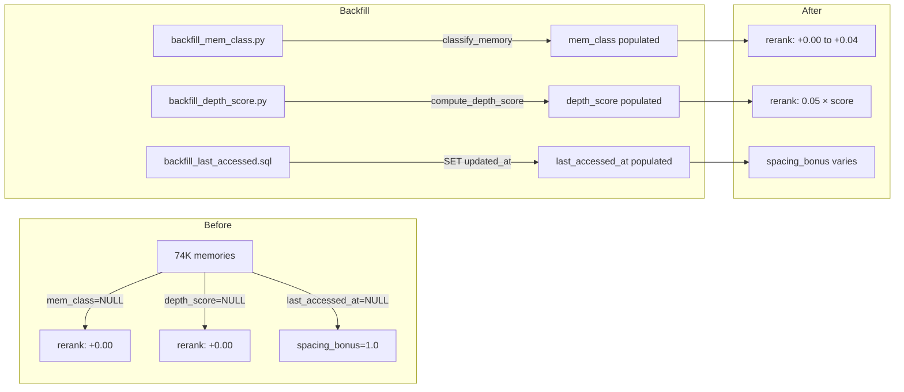
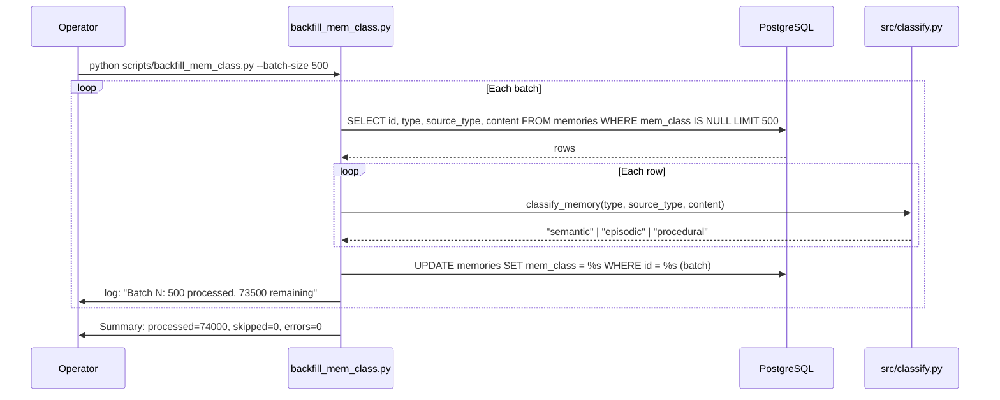

# Design Document: V2 Reranking Backfill

## Overview

This feature delivers three backfill scripts that populate the `mem_class`, `depth_score`, and `last_accessed_at` columns for all ~74K existing memories. These columns were added in migration `002_v2_columns.sql` and are consumed by the `rerank()` function in `src/search.py`, but currently return NULL (and therefore contribute zero signal) for every legacy memory.

The backfill is structured as three independent, idempotent scripts:

1. `scripts/backfill_mem_class.py` — calls `classify_memory()` from `src/classify.py` to populate the `mem_class` column.
2. `scripts/backfill_depth_score.py` — calls `compute_depth_score()` from `src/depth.py` to populate `metadata.depth_score` in the JSONB column.
3. `scripts/backfill_last_accessed.sql` — a single SQL statement setting `last_accessed_at = updated_at` where NULL.

All Python scripts share a consistent CLI interface (`--batch-size`, `--dry-run`, `--limit`) and produce structured logging with batch progress and a final summary. The existing `scripts/golden_queries.py` benchmark is run before and after to measure retrieval quality impact.



## Architecture

### Design Decisions

**Separate scripts vs. single unified backfill**: Each column gets its own script because:
- They can be run independently and in any order.
- Failure in one doesn't block the others.
- The SQL-only `last_accessed_at` backfill has no Python dependency.
- Operators can re-run a single script if interrupted.

**Batch-commit strategy**: Each batch is committed in its own transaction. This avoids holding a single long-running transaction across 74K rows, which would bloat WAL and risk lock contention. If the script crashes mid-run, already-committed batches are durable and the idempotent WHERE clause skips them on re-run.

**No migration file for data backfill**: The backfill scripts live in `scripts/` rather than `migrations/` because they are one-time data fixes, not schema changes. The schema columns already exist from `002_v2_columns.sql`.

**Reuse of existing pure functions**: `classify_memory()` and `compute_depth_score()` are pure functions with no I/O dependencies. The backfill scripts call them directly rather than reimplementing classification or scoring logic.

### Component Interaction



## Components and Interfaces

### 1. `scripts/backfill_mem_class.py`

**Purpose**: Populate `mem_class` column for all memories where it is NULL.

**CLI Interface**:
```
python scripts/backfill_mem_class.py [--batch-size N] [--dry-run] [--limit N]
```

| Argument | Type | Default | Description |
|---|---|---|---|
| `--batch-size` | int | 500 | Rows per batch/transaction |
| `--dry-run` | flag | False | Compute but don't commit writes |
| `--limit` | int | None | Cap total rows processed |

**Core Logic**:
- Query: `SELECT id, type, source_type, content FROM memories WHERE mem_class IS NULL ORDER BY id LIMIT <batch_size>`
- For each row: call `classify_memory(type, source_type, content)`
- Batch update: `UPDATE memories SET mem_class = %s WHERE id = %s`
- Commit per batch (or rollback if `--dry-run`)
- Continue fetching until no more NULL rows or `--limit` reached

**Output**: Progress logs per batch + final summary with counts per classification.

### 2. `scripts/backfill_depth_score.py`

**Purpose**: Populate `metadata.depth_score` for all memories where it is NULL.

**CLI Interface**:
```
python scripts/backfill_depth_score.py [--batch-size N] [--dry-run] [--limit N]
```

| Argument | Type | Default | Description |
|---|---|---|---|
| `--batch-size` | int | 500 | Rows per batch/transaction |
| `--dry-run` | flag | False | Compute but don't commit writes |
| `--limit` | int | None | Cap total rows processed |

**Core Logic**:
- Query: `SELECT id, content, metadata FROM memories WHERE metadata->>'depth_score' IS NULL ORDER BY id LIMIT <batch_size>`
- For each row: call `compute_depth_score(content)`, merge into existing metadata dict
- Batch update: `UPDATE memories SET metadata = %s WHERE id = %s` (full JSONB replacement with merged dict)
- Uses Python-side merge: read existing metadata dict, add `depth_score` key, write back full dict
- Commit per batch (or rollback if `--dry-run`)

**Output**: Progress logs per batch + final summary with min/max/mean depth scores.

### 3. `scripts/backfill_last_accessed.sql`

**Purpose**: Set `last_accessed_at = updated_at` for all memories where `last_accessed_at IS NULL`.

**Contents**:
```sql
-- Preview: how many rows will be affected?
SELECT count(*) AS rows_to_update
FROM memories
WHERE last_accessed_at IS NULL;

-- Backfill: set last_accessed_at to updated_at for all NULL rows
UPDATE memories
SET last_accessed_at = updated_at
WHERE last_accessed_at IS NULL;
```

This is a standalone SQL file, not a Python script. The operator runs it via `psql` or a similar tool. It is idempotent — re-running affects zero rows.

### 4. Shared CLI Argument Parser (utility)

A small helper function (e.g., `_parse_backfill_args()`) used by both Python backfill scripts to ensure consistent argument parsing:

```python
def _parse_backfill_args(description: str, default_batch_size: int = 500) -> argparse.Namespace:
    parser = argparse.ArgumentParser(description=description)
    parser.add_argument("--batch-size", type=int, default=default_batch_size)
    parser.add_argument("--dry-run", action="store_true")
    parser.add_argument("--limit", type=int, default=None)
    return parser.parse_args()
```

With only two Python scripts, this function is duplicated in each script rather than extracted to a shared module.

## Data Models

### Memories Table (relevant columns)

| Column | Type | Source | Backfill Script |
|---|---|---|---|
| `id` | UUID | PK | — |
| `type` | TEXT | existing | — |
| `source_type` | TEXT | existing | — |
| `content` | TEXT | existing | — |
| `metadata` | JSONB | existing | `backfill_depth_score.py` merges `depth_score` key |
| `mem_class` | TEXT | `002_v2_columns.sql` | `backfill_mem_class.py` |
| `last_accessed_at` | TIMESTAMPTZ | `002_v2_columns.sql` | `backfill_last_accessed.sql` |
| `updated_at` | TIMESTAMPTZ | existing | used as source for `last_accessed_at` |

### Classification Values

`classify_memory()` returns one of three string literals:
- `"semantic"` — ideas, syntheses, insights, decisions, connections, priorities, projects, questions
- `"episodic"` — sources, raw logs
- `"procedural"` — content matching step-by-step / how-to patterns

### Depth Score

`compute_depth_score()` returns a `float` in `[0.0, 1.0]` based on weighted signals (causal connectors, code blocks, questions section, word count, specific numbers, named tools, connection phrases). Stored as `metadata->>'depth_score'`.

### Reranking Formula Consumption

From `src/search.py` `rerank()`:
- `mem_class_boost = {"semantic": 0.04, "procedural": 0.02}.get(mem_class, 0.0)`
- `depth_score = (metadata or {}).get("depth_score", 0.0)` → contributes `0.05 * depth_score`
- `spacing_bonus = compute_spacing_bonus(last_accessed_at)` → modulates `0.03 * log1p(access_count) * spacing_bonus`


## Correctness Properties

*A property is a characteristic or behavior that should hold true across all valid executions of a system — essentially, a formal statement about what the system should do. Properties serve as the bridge between human-readable specifications and machine-verifiable correctness guarantees.*

### Property 1: mem_class backfill consistency

*For any* memory with a given `type`, `source_type`, and `content`, after `backfill_mem_class.py` runs, the stored `mem_class` value in the database SHALL equal `classify_memory(type, source_type, content)`.

**Validates: Requirements 1.1, 1.2**

### Property 2: depth_score backfill consistency

*For any* memory with given `content`, after `backfill_depth_score.py` runs, the stored `metadata->>'depth_score'` value in the database SHALL equal `compute_depth_score(content)`.

**Validates: Requirements 2.1**

### Property 3: Metadata preservation during depth_score merge

*For any* memory with arbitrary existing metadata keys, after `backfill_depth_score.py` merges `depth_score` into the JSONB column, all pre-existing metadata keys and their values SHALL be preserved unchanged.

**Validates: Requirements 2.2**

### Property 4: mem_class backfill idempotence

*For any* set of memories, running `backfill_mem_class.py` twice SHALL produce the same database state — the second run processes zero rows because all `mem_class` values are already non-NULL.

**Validates: Requirements 1.5**

### Property 5: depth_score backfill idempotence

*For any* set of memories, running `backfill_depth_score.py` twice SHALL produce the same database state — the second run processes zero rows because all `metadata->>'depth_score'` values are already non-NULL.

**Validates: Requirements 2.5**

### Property 6: last_accessed_at backfill idempotence

*For any* set of memories, running the `backfill_last_accessed.sql` UPDATE twice SHALL produce the same database state — the second execution affects zero rows.

**Validates: Requirements 3.2**

### Property 7: Dry-run leaves database unchanged

*For any* set of memories with NULL `mem_class` or NULL `depth_score`, running the corresponding backfill script with `--dry-run` SHALL leave all database values unchanged (no rows updated).

**Validates: Requirements 4.1**

### Property 8: Limit flag caps total processed

*For any* positive integer N passed as `--limit`, the backfill script SHALL process at most N memories, regardless of how many NULL rows exist in the database.

**Validates: Requirements 6.3**

## Error Handling

### Per-Row Error Isolation

Both Python backfill scripts wrap each individual `classify_memory()` / `compute_depth_score()` call in a try/except. If a single memory fails:
- The error is logged with the memory ID and exception message.
- The error counter is incremented.
- Processing continues with the next memory in the batch.
- The batch is still committed (minus the failed row's update).

This ensures one corrupt or unusual memory doesn't halt the entire 74K-row backfill.

### Batch-Level Error Handling

If a batch UPDATE or COMMIT fails (e.g., database connection lost):
- The transaction is rolled back for that batch.
- The error is logged with the batch range.
- The script exits with a non-zero exit code.
- On re-run, the idempotent WHERE clause skips already-processed rows, so no data is duplicated.

### CLI Argument Validation

- `argparse` handles type validation and unknown arguments automatically.
- Invalid `--batch-size` (≤ 0) or `--limit` (≤ 0) values are rejected with a usage message and non-zero exit.

### Dry-Run Safety

In dry-run mode, the script uses `conn.rollback()` instead of `conn.commit()` after each batch. This ensures no writes persist even if the rollback logic has a bug — the transaction is never committed.

## Testing Strategy

### Property-Based Testing

Property-based tests use **Hypothesis** (already used in this project — see `.hypothesis/` directory and existing `test_search_properties.py`). Each correctness property maps to a single Hypothesis test.

**Configuration**:
- Minimum 100 examples per property test (`@settings(max_examples=100)`)
- Each test is tagged with a comment: `# Feature: v2-reranking-backfill, Property N: <title>`

**Property tests** (require `test_db` fixture for database access):

| Property | Test Description | Generator Strategy |
|---|---|---|
| P1: mem_class consistency | Generate random memories with varied type/source_type/content, run backfill, verify stored value matches `classify_memory()` | `st.sampled_from(types) × st.text()` |
| P2: depth_score consistency | Generate random memories with varied content, run backfill, verify stored value matches `compute_depth_score()` | `st.text(min_size=0, max_size=5000)` |
| P3: Metadata preservation | Generate random existing metadata dicts, run depth_score backfill, verify all original keys preserved | `st.dictionaries(st.text(), st.text())` |
| P4: mem_class idempotence | Generate memories, run backfill twice, verify second run processes zero rows | Reuse P1 generators |
| P5: depth_score idempotence | Generate memories, run backfill twice, verify second run processes zero rows | Reuse P2 generators |
| P6: last_accessed_at idempotence | Insert memories with NULL last_accessed_at, run SQL twice, verify second run affects 0 rows | `st.datetimes()` for updated_at |
| P7: Dry-run no writes | Generate memories, run with --dry-run, verify all values still NULL | Reuse P1/P2 generators |
| P8: Limit cap | Generate N memories, run with --limit M where M < N, verify exactly M processed | `st.integers(min_value=1, max_value=50)` |

### Unit Tests

Unit tests cover specific examples, edge cases, and integration points:

- **CLI argument parsing**: default values, custom values, invalid inputs, usage message on error
- **Batch progress logging**: verify log output contains batch count and remaining count
- **Summary output**: verify final summary contains all required fields (processed, skipped, errors, breakdown)
- **Dry-run log prefix**: verify `[DRY RUN]` prefix appears in output
- **Error isolation**: inject a memory that causes `classify_memory` to raise, verify other memories in batch still processed
- **SQL file contents**: verify `backfill_last_accessed.sql` contains the SELECT count(*) and UPDATE statements
- **Empty database**: verify scripts handle zero NULL rows gracefully (no errors, summary shows 0 processed)

### Test File Organization

- `tests/test_backfill_mem_class.py` — property + unit tests for mem_class backfill
- `tests/test_backfill_depth_score.py` — property + unit tests for depth_score backfill
- `tests/test_backfill_last_accessed.py` — property + unit tests for last_accessed SQL
- All tests use the existing `test_db`, `clean_tables`, and `sample_memory_factory` fixtures from `conftest.py`
