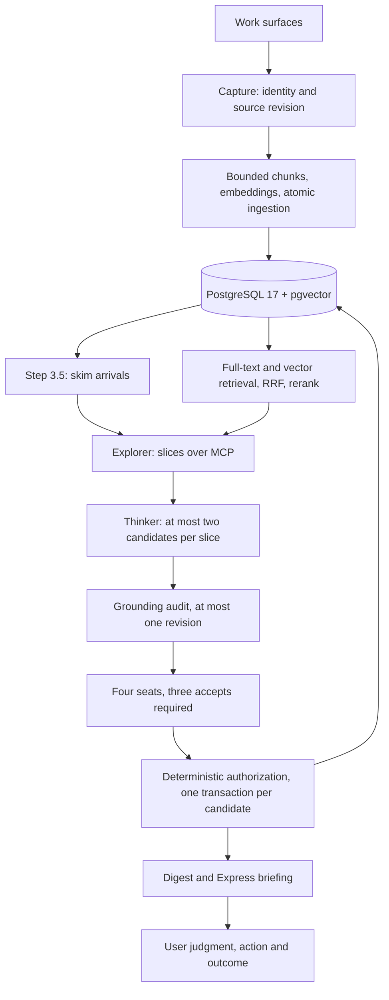

# Architecture

Describes the code at the R7 head of the release line. Which parts are deployed is in [RELEASES.md](RELEASES.md); operational qualification is in the private release notes, not here.

## Storage and ingestion

`src/db/` owns pooled connections (`pool.py`: `ThreadedConnectionPool`, bounded wait, `transaction()` owns commit/rollback, `SET LOCAL statement_timeout`/`lock_timeout`), scalar projections (`columns.py`), memory and relationship queries, capture/search/express query modules and the maintenance planners (`maintenance.py`). Borrowers return clean connections; writers that accept `conn=` participate in the caller's transaction without committing. Dynamic columns use `psycopg2.sql.Identifier` and a field allowlist.

`src/ingest.py` prepares bounded chunks and embeddings (provider input bounded; an oversized leaf is stored whole with a recorded truncation, never silently sliced) before committing the source revision and its children together. Failure leaves the preceding complete source intact. Capture identity is channel + source URL (`find_captured_source`); `project` is descriptive and may change without creating a new identity, so identical prose in different projects is not automatically a duplicate, and several derived task memories may share one Codex task URL.

`memories` holds raw evidence, derived notes, vectors, source metadata, optional parent, status, project, access history and encoding context. `memory_relationships` records typed edges with lifecycle timestamps; `derived_from` and `superseded_by` are provenance and never expire (CHECK in migration 016); other edges expire only after a 90-day age grace and when both endpoints are unaccessed. Reads filter expired edges and return the other endpoint for either direction. `dream_cycle_runs`, `dream_cycle_candidates`, `dream_cycle_slices`, `memory_skim`, `express_feedback` and the `corpus_maintenance` ledger complete the schema; the knowledge-graph tables `entities`, `entity_edges`, `memory_entities` are dropped by migration 018 after a verified encrypted export ([DISASTER-RECOVERY.md](DISASTER-RECOVERY.md), "Knowledge-graph archive") and no code reads or writes them (`tests/test_migration_018.py` pins the repository).

Migrations, not this prose, define columns and indexes. `migrations/migrate.sh` applies each SQL file and its ledger row in one transaction under an advisory lock, connected as the owner role; the application role holds DML only ([OPERATIONS.md](OPERATIONS.md), "Database roles").

## Retrieval

Lexical retrieval is PostgreSQL full-text search over a weighted `tsvector`; vector retrieval is pgvector HNSW (`hnsw.ef_search` set per database by migration 009, `hnsw.iterative_scan = relaxed_order` per query). Reciprocal rank fusion combines the two candidate lists before utility reranking; the pure filter/fusion/dedup helpers live in `src/retrieval.py`, the queries in `src/db/search_queries.py`. The full-text leg includes unembedded sources and parents without active chunks; only the vector leg requires an embedding, so a source lacking a vector stays discoverable by its words.

Ranking weights have one home in `src/rerank_weights.py`; source classifications derive from `src/validation.py`. Context overlap, status, recency, access history, depth and project affect ranking. A project filter is a deliberate scope restriction; cross-project discovery must not apply it silently. The offline 36-query fixture (`tests/test_retrieval_quality_gate.py`) exercises the real query path with synthetic embeddings and establishes regressions, not real-world quality.

## Discovery and learning

`src/dream_cycle/orchestrator.py` coordinates; `agents/`, `stages/`, `repository/`, `budget.py`, `run_result.py` and `digest.py` do bounded work. Step 3.5 skims arrivals into validated structured records ([SKIM-STAGE.md](SKIM-STAGE.md)); skim output guides attention and proves nothing. The Explorer runs on Claude Code with `python -m src.mcp_server` attached over MCP — the full interactive registry, not the read-only one in `src/mcp_readonly.py` (see [INTERFACES.md](INTERFACES.md)); the Thinker and the four seats are tool-less direct Bedrock calls that receive bounded source packets inline (`src/dream_cycle/packet.py`).

The Thinker proposes at most two candidates per slice. Before the vote, one graded grounding audit is made through the skeptic seat's backend (`GROUNDING_AUDIT_ROLE`, `src/dream_cycle/stages/grounding.py`), skipped once the run has spent the configured share of its cap; blocking issues allow one tool-less revision in which sources may only shrink and provenance is kept in `candidate_json.revision`. The audit record is omitted from the voting projection. Four seats (skeptic, advocate, epistemologist, methodologist) return exact `ACCEPT`/`REJECT` verdicts with reasoning and graded details; three accepts are required; the controlled profile puts two model families on the panel. Votes remain correlated judgments — scores and issue lists are not separate vetoes.

Panel acceptance does not grant write authority. Storage (`src/dream_cycle/storage.py`) checks source and target membership, actual source snapshots, current existence and status, protected guidance and captured evidence, and valid relationships; candidates are authorized **before** seat spend; ordered row locks stop a stale proposal from overwriting a changed target; memory mutation, relationships and the accepted-candidate ledger row commit together, and a failed candidate does not erase earlier successes. A run advisory lock prevents overlapping runs; `SIGTERM` closes the run row (`RunInterrupted`) within the job runner's grace. Cost and accounting failures abort truthfully, retaining completed counts and unjudged work ([MODEL-BACKENDS.md](MODEL-BACKENDS.md) for the spend threshold, reservations and unknown-usage behaviour). Digests are written to `logs/digests/` with stable run identity and feedback links.

## Delivery and feedback

Express (`src/express.py`, `src/db/express_queries.py`) gathers insights, contradictions, resurfaced material, questions and digests; deterministic editing supports local briefings without a model; the model editor is the explicit metered `editor` role (see `memory_brief` in [INTERFACES.md](INTERFACES.md)). Email requires configuration and its preflight gate before paid editing; the scheduled email push after the dream cycle stays disabled (`scripts/jobs/dream_cycle_scheduled.sh`) and is a product decision, not an operational default.

Delivery preference feedback exists (`express_feedback`); absence of feedback is unknown. A displayed item is not a used item, and a used item is not automatically an improved outcome. The effectiveness ledger must join exact source revisions, candidate and output version, delivery, user judgment, action and outcome ([VALIDATION.md](VALIDATION.md)). Imported upstream confidence values do not implement a Bayesian learning loop here.
