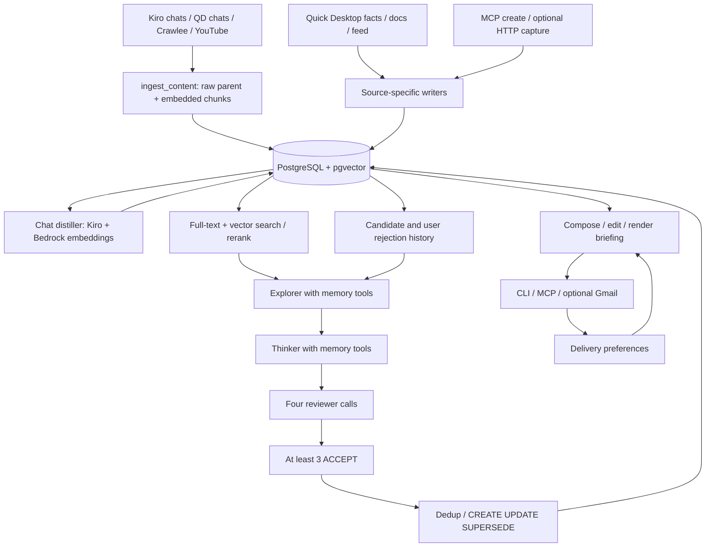

# Architecture — original implementation

Source-reviewed 2026-09-10. This guide describes implemented paths and their limitations. [Start here](START-HERE.md) identifies the version; [Operations](OPERATIONS.md) separates configuration from operation.

## Data flow

Raw ingestion and later distillation are distinct scheduled/manual stages. The entity knowledge graph is stored separately from memory relationships and is not used by core retrieval or the dream cycle.

## Component contracts

| Component and entrypoint | Inputs → outputs; stored state | Dependencies and failure behavior | Verification surface |
|---|---|---|---|
| `src/ingest.py:ingest_content` | Markdown+header → unembedded full parent and embedded child memories, optional `related_to` edges | Bedrock and DB; each record commits separately. A failure may leave a partial source; relationship discovery failures are swallowed | `test_ingest_v2.py`, `test_ingest_interactions.py`, `test_cli_chat.py`, `test_ide_chat.py` |
| `src/db.py` | CRUD, similarity SQL, relationships, temporal/schema lookups → row dictionaries/IDs | `SimpleConnectionPool`, DB env at module import; checkout probes reconnect, writes commit per helper | `test_db.py`, `test_pool_properties.py` |
| `src/embeddings.py` | Text, truncated to 25,000 chars → 1024-dimensional vector | `boto3` Bedrock runtime; lazy client, error propagates; batch is sequential | Callers' mocked tests; real provider probe is separate |
| `src/search.py` | Query text+embedding+filters → fused, deduplicated candidate rows; rerank adds score | PostgreSQL FTS and pgvector; requires embeddings even on the FTS branch. MCP search separately increments access counters | Search, question-search, rerank and property tests |
| `scripts/distill_sessions.py` | Undistilled chat parent text → decisions/insights and possible contradiction edges | Kiro compatibility invoker, Bedrock embeddings, DB; partial failures logged; CLI does not translate failure totals to nonzero exit | `test_distill.py` |
| `src/dream_cycle/orchestrator.py` | Run type/scope, DB stats/history → candidate records, accepted memory operations, digest | Six role-resolved invocations; Explorer/Thinker request tools; reviewers request `tools=False`, with adapter-dependent isolation. Empty Explorer aborts; failed Thinker slice skips; unrecoverable panel aborts | Dream-cycle run, orchestrator, prompt, consensus and storage tests |
| `src/dream_cycle_db.py` | Run/candidate/feedback CRUD → persisted process history and aggregate metrics | DB; candidate rejection can mark associated memory `user_rejected` | `test_dream_cycle_db.py`, feedback/evaluation properties |
| `src/express.py` | Existing memories/relationships+preferences → composed/edited Markdown/email | DB; editor uses Kiro alias by default; model failure or empty model selection falls back to deterministic items | `test_express.py` |
| `src/mcp_server.py` | Nine stdio MCP tools → reads, writes, search, learning prompt, briefing | Python environment, DB; create/content-update/search/learn require embeddings | `test_mcp_server.py`, `test_integration.py` |
| `src/capture_api.py` | Authenticated HTTP capture payloads → one embedded memory | FastAPI, token env, DB, Bedrock; localhost:8100 default, write error→HTTP500; health probes DB only | `test_capture_api.py` |
| `scripts/weekly_digest.py` | Recent tag/project/source counts and decision titles → one weekly synthesis | Kiro alias, Bedrock, DB; source URL dedup by ISO week; optional macOS notification | `test_digest_properties.py` |
| Jobs and backup | launchd templates → source-specific scripts/logs/state/dumps | Hardcoded paths and mixed exit fidelity; template presence is not runtime proof | [Operations](OPERATIONS.md), [Recovery](DISASTER-RECOVERY.md) |

Helpers `classify.py`, `depth.py`, `project.py`, and `qd_profile.py` classify records, heuristically score depth, normalize project tags, and locate upstream profiles. They do not prove source accuracy, meaningful project identity, or semantic quality.

## Storage and schema

The schema directory contains **12 SQL files numbered 000–011**: tracking plus 11 numbered changes. Installed migration state must be read from the target database; file presence is not evidence of application.

| Migration | Responsibility |
|---|---|
| 000 / 001 | Migration tracking; core memories, relationships, vector/full-text indexes and search trigger |
| 002 | `mem_class`, `project`, `last_accessed_at` |
| 003 / 004 | Dream-cycle run/candidate history, relationship `expired_at`, fourth reviewer fields |
| 005 | Weighted title/question/body search vector trigger and backfill |
| 006 | `encoding_context` field/index |
| 007 | Partial indexes for `type='schema'` and `derived_from`; no `schema_type` column |
| 008 | `entities`, `entity_edges`, `memory_entities` imported graph tables |
| 009 | HNSW rebuild parameters; hardcoded `ALTER DATABASE memory_bank SET hnsw.ef_search=200` |
| 010 | `express_feedback` delivery preferences |
| 011 | Per-role `backend_provenance` on `dream_cycle_runs` |

`memories` stores UUID, type/title/content/summary, `vector(1024)`, tags, source URL/type, JSON metadata, status/confidence, parent pointer, timestamps, FTS vector, access counts, class/project/context. The schema accepts string types/statuses; application prompts are not database enums. `created_at` generally means insertion time; source dates may live only in metadata. Do not treat bulk-import insertion times as original event dates.

`memory_relationships` is a directed `(source_id,target_id,relation_type)` key with note/timestamps. `derived_from` points from a synthesis to its evidence; `superseded_by` points old→new. `entities` has a separate 1536-dimensional embedding column; it is not compatible with the memory vector column. Graph imports and Slack channel/user imports do not imply graph-aware discovery or Slack message capture.

`dream_cycle_runs` stores execution metadata; `dream_cycle_candidates` stores proposal, individual verdicts, final vote, created memory ID, and rejection fields. Legacy DEFERRED columns remain, but current consensus only returns ACCEPTED/REJECTED. There are no immutable source revisions or exact-version delivery receipts in this original lineage.

## Retrieval

`hybrid_search` combines cosine HNSW ranks with PostgreSQL `ts_rank(to_tsquery(...))`, then Reciprocal Rank Fusion (`k=60`). **The lexical implementation is PostgreSQL full-text ranking, not BM25**, despite that shorthand in older comments. Candidate prefetch is4×limit; content-prefix dedup and a two-per-parent cap reduce repeated chunks. Filtering by project keeps matching or null-project rows, so a scoped search can hide relevant other-project records.

`rerank` uses centralized weights in `src/rerank_weights.py`: RRF, lexical/title/context overlap, recency, length, depth; plus class/type boosts, spaced access reinforcement, cross-project/superseded/staleness penalties. These are heuristics, not learned probabilities. The code prefers some kinds of recently accessed content, and measures of recall must account for that history.

`memory_search` embeds the query, calls hybrid search/rerank, **writes** access counters, and returns500-character previews plus temporal neighbors and schema context. Read full source records before judging evidence. `memory_read` does not increment access counts. Temporal neighbors use database `created_at`; no claim of original event chronology follows. The default search status is unfiltered, so `user_rejected` is not globally suppressed unless callers filter appropriately.

## Discovery and learning

1. `DreamCycleOrchestrator.run` chooses one of scheduled, post_learn, session_start, or user_triggered modes, creates run history, gathers stats and rejection feedback.
2. Explorer gets the live memory tools, strategy guidance and current scope. Prompts suggest up to five slices; most shape/quantity limits are prompt instructions, not strict validated contracts.
3. Thinker receives slice IDs/hypothesis and tools; proposes CREATE, UPDATE, or SUPERSEDE with source IDs and suggested relationships.
4. Skeptic, Advocate, Epistemologist, and Methodologist run **sequentially**, each in a separate call. They receive candidate JSON and a list of source IDs, with no source content in the prompt. These calls request `tools=False`; actual tool isolation depends on the adapter. Source IDs alone do not permit independent evidence verification.
5. `tally_consensus` accepts at least three ACCEPT votes out of four. Same-model role prompts can share errors. The “BFT” terminology in original code is an analogy, not a guarantee of truth or independent fault tolerance. There is no Bayesian posterior calculation here.
6. Accepted candidates pass embedding similarity dedup before storage. That gate applies to UPDATE/SUPERSEDE too and can suppress the intended update by matching the target. Candidate ACCEPTED can be recorded with no created memory. Storage helpers commit separately, and UPDATE overwrites content without preserving its previous version.
7. Digest/run history records results; stale relationship expiry is best effort. A later Explorer receives recent rejected-candidate reasoning, dissent on accepted candidates, and recorded user rejections.

Only the dream cycle's six roles are controlled by backend profiles. See [Model backends](MODEL-BACKENDS.md). Original source lineage is candidate/source IDs rather than quote-validated evidence packets.

## Delivery and feedback

Express gathers recent dream-cycle insights, active contradictions, resurfaced records, a digest, and open questions. It truncates detail to 600 characters **before** the editor/render stage; caveats and provenance may be lost. A cross-project flag can arise from a strategy label alone or multiple non-null source project tags; neither proves a useful cross-project transfer.

The editor selects up to five items, adds headlines, and falls back deterministically on failure. An intentional empty editor selection also falls back, so “nothing worth showing” is not fully respected. CLI, in-session MCP, and optional Gmail use the same composition layer. The email gate checks the latest completed run's accepted candidate JSON, while composition separately gathers eligible memories. A triggering accepted duplicate or muted item need not appear in the sent briefing. The only resend guard is `logs/.express_last_push`, not an immutable delivery ledger.

There are **three different feedback mechanisms**:

- Search access counters influence retrieval ranking; they do not measure usefulness or citations.
- `express_feedback` stores latest useful/less/mute preference per item/kind/topic and influences delivery only.
- `mark_user_rejected` updates candidate/memory status and recent rejection text can enter Explorer. There is no exposed MCP or `brief` command for this function, and no complete version-aware correction/acceptance/outcome loop.

Quick Desktop confidence is imported data, not evidence that these feedback mechanisms perform Bayesian learning. See [Capture](CAPTURE-COMPONENTS.md#quick-desktop-integration).
