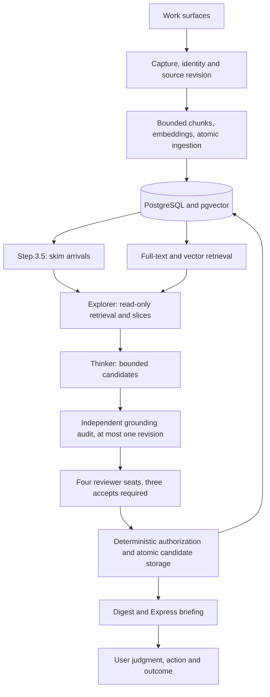

# Architecture

This describes the original implementation's refactor branch. Source behavior and operational qualification are tracked separately in [the completion ledger](REFACTOR-COMPLETION-2026-09-26.md).

## Storage and ingestion

`src/db/` owns pooled connections, scalar projections, memory queries, capture queries and typed relationships. The thread-safe pool has a bounded wait. Borrowers return clean connections; `transaction()` owns commit/rollback and optional `conn=` writer arguments participate without an independent commit. Dynamic columns use `psycopg2.sql.Identifier` and a field allowlist.

`src/ingest.py` prepares bounded chunks and embeddings before committing the source revision and its children together. Failure must leave the preceding complete source intact. Capture identity includes channel, source URL, project and raw-source semantics. Identical prose in different projects is not automatically a duplicate. Multiple derived task memories may legitimately share one source URL.

`memories` retains raw evidence, derived notes, vectors, source metadata, optional parent, status, project, access history and encoding context. `memory_relationships` records typed source/target edges and lifecycle timestamps. `derived_from` and `superseded_by` are provenance and never age out. Other edges expire only after the creation grace and when both endpoints are unaccessed. Reads filter expired edges and return the other endpoint, including incoming edges.

Migrations, not this prose, define columns/indexes. The runner uses a transaction and advisory lock for each SQL file and its ledger entry. The historical graph tables can remain in backups even after their unused writers are retired. Table retirement is a separate recoverable operation.

## Retrieval

Lexical retrieval uses PostgreSQL full-text search; it is not a separate BM25 service. Vector retrieval uses pgvector. Reciprocal rank fusion combines candidates before utility reranking. The full-text leg includes unembedded sources/parents; only the vector leg requires an embedding. A source lacking a vector must remain discoverable by its words.

Ranking weights have one home in `src/rerank_weights.py`; source classifications derive from `src/validation.py`. Context overlap, status, recency, access history, depth and project affect ranking. A project filter is a deliberate scope restriction, so cross-project discovery must not silently apply it everywhere. The offline retrieval quality fixture exercises the actual query path with synthetic embeddings; it establishes regressions, not real-world semantic quality.

## Discovery and learning

The orchestrator coordinates stages; stage/agent modules perform bounded work. Step 3.5 skims arrivals into validated structured records. It does not prove a discovery. Explorer reads through an explicit read-only MCP registry. In the controlled route the Thinker and review roles receive bounded source packets over Bedrock.

Thinker proposes at most two candidates per slice. A separate `grounding_auditor` can request one revision. Audit/revision metadata remains in the ledger but is omitted from voting-seat projections to reduce anchoring. Four seats return exact ACCEPT/REJECT verdicts with reasoning and optional graded details. Three accepts are required; the controlled configuration uses two model families. Votes remain correlated judgments, and scores or issue lists are not separate vetoes.

Panel acceptance does not grant write authority. Storage checks source and target membership, actual source snapshots, current existence/status, protected guidance/captured evidence, and valid relationships. Ordered row locks prevent a stale proposal from overwriting a changed target. Memory mutation, relationships and the accepted candidate ledger commit together. Failed candidates do not erase earlier successful candidates.

A run lock prevents overlapping discovery runs. Cost/accounting failures abort truthfully, retaining completed counts and unjudged work. Digests have stable run identity and explicit feedback links. See [Models](MODEL-BACKENDS.md) for the post-response spend threshold and unknown-usage behavior.

## Delivery and feedback

Express gathers insights, contradictions, resurfaced material, questions and digests; deterministic editing supports local briefings without a model. The model editor is an explicit metered role. Email requires configuration and its preflight gate before paid editing. The scheduled email push remains a distinct product/operational decision.

Delivery preference feedback exists; absence of feedback is unknown. A displayed item is not a used item, and a used item is not automatically an improved outcome. The effectiveness ledger must join exact source revisions, candidate/output version, delivery, user judgment, action and outcome. Imported upstream confidence values do not implement a Bayesian end-to-end learning loop here.
